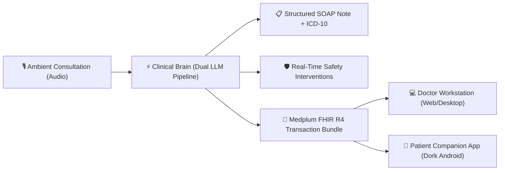

# ⚡ Proton — Interactive Project Trailer & Preview

<p align="center">
  
</p>

<p align="center">
  <b>A 60-second interactive taste of Proton</b> — The Next-Generation Ambient Clinical Operating System, Doctor Workstation, and Patient Healthcare Platform.
</p>

<p align="center">
  <a href="https://github.com/abhijeetdinkale-arch/proton"></a>
  
  
  
  
</p>

---

## 🎬 What is Proton?

**Proton** bridges the gap between clinicians and patients by listening ambiently to doctor-patient consultations, instantaneously drafting structured **SOAP notes**, intercepting contraindications with **clinical safety guardrails**, and syncing authoritative medical timelines to the **Dork** patient mobile application.



---

## ⚡ 1. The 10-Second Terminal Taste (Zero Dependencies)

Experience Proton's ambient transcription, SOAP generation, safety guardrail interception, and FHIR serialization directly in your terminal:

```bash
# Clone and run immediately with vanilla Node.js:
git clone https://github.com/abhijeetdinkale-arch/proton-trailer.git
cd proton-trailer
node demo.mjs
```

### What You'll See:
1. **Dual-Channel Ambient Intake**: Simulated audio stream between physician and patient.
2. **Synchronous SOAP Extraction**: Real-time generation of Subjective, Objective, Assessment, and Plan with ICD-10 coding.
3. **Clinical Safety Hard Stop**: Automatic allergy cross-check catching a penicillin contraindication and proposing an evidence-based alternative (Azithromycin).
4. **HL7 FHIR R4 Bundle**: Verified transaction bundle ready for Medplum EHR storage.

---

## 🌐 2. Interactive Web Trailer

Run the full interactive browser cockpit simulator with live waveform audio, interactive patient app preview, and contraindication testing:

```bash
npm install
npm run dev
```

Open [http://localhost:3000](http://localhost:3000) to explore:
* **Interactive Scribe Cockpit**: Click *Play Stream* to watch real-time transcription and synchronous SOAP extraction.
* **Safety Guardrails**: Inspect live contraindications, drug-allergy conflicts, and safe substitution rationale.
* **Dork Patient App Simulator**: Test conversational AI appointment booking with interactive slot selection.
* **FHIR R4 Inspector**: Review Medplum-compatible transaction payloads.

---

## 🔬 Core Platform Highlights

| Capability | Architecture & Implementation |
| :--- | :--- |
| **Ambient Clinical Scribe** | Dual-channel voice streaming, real-time medical entity extraction, automatic ICD-10 coding, and structured SOAP drafting. |
| **Clinical Safety Engine** | Hard stop contraindication checks, black box warning verification, and evidence-grounded non-device CDS recommendations. |
| **Doctor Workstation** | React + TypeScript web console featuring timeline reviews, e-prescribing, EHR C-CDA imports, and customizable UI palettes. |
| **Patient App (Dork)** | 100% Kotlin + Jetpack Compose Android app with SQLCipher encryption, longitudinal lab trends, and AI booking agent. |
| **Desktop OS Engine** | Native macOS Electron container with automated backend process orchestration and HL7 v2 / DICOM hardware gateway readiness. |

---

## 📦 Full Monorepo Access

Ready to explore the complete source code, backend services, and Android application?

👉 **[Visit the Primary Proton Monorepo on GitHub](https://github.com/abhijeetdinkale-arch/proton)**

Includes:
* `apps/api`: Express & PostgreSQL / Medplum backend services
* `apps/web`: Full clinical doctor workstation
* `apps/proton-desktop`: Electron macOS clinical desktop operating system
* `apps/dork-android`: Jetpack Compose patient health companion

---

<p align="center">
  <sub>Built with precision for modern healthcare by <a href="https://github.com/abhijeetdinkale-arch">Abhi Dinkale</a></sub>
</p>
